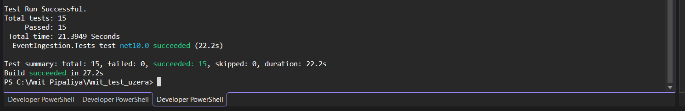
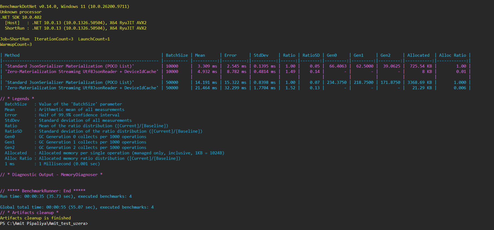

# IoT Event Ingestion Service

High-throughput event ingestion service built with **.NET 10 Web API (C#)**. It ingests batches of sensor readings (up to 50,000 readings per call) and maintains continuous rolling aggregates (**count**, **min**, **max**, and **average**) per device over a **5-minute sliding window** in memory.

---

## Getting Started

### Prerequisites
- [.NET 10 SDK](https://dotnet.microsoft.com/download/dotnet/10.0)

### 1. Build the Solution
```powershell
dotnet build EventIngestion.sln
```

### 2. Run the Automated Tests (15 Tests)
```powershell
dotnet test tests/EventIngestion.Tests/EventIngestion.Tests.csproj --logger "console;verbosity=normal"
```

> **Note:** A screenshot of the test run executed on my local machine is saved at `screenShot/Test.png`, showing all 15 tests passing successfully.



### 3. Run the Web API
```powershell
dotnet run --project src/EventIngestion.Api
```

Once started, open your browser:
- **Swagger UI:** `http://localhost:5104/` or `https://localhost:7179/`
- **OpenAPI JSON:** `http://localhost:5104/swagger/v1/swagger.json`

---

## API Endpoints

### 1. Ingest Batch of Sensor Readings
- **Method:** `POST /api/readings/batch`
- **Content-Type:** `application/json`
- **Description:** Streams up to 50,000 readings directly from the HTTP body without loading them all into a List in memory.

#### Example Request:
```bash
curl -X POST "http://localhost:5104/api/readings/batch" \
  -H "Content-Type: application/json" \
  -d '[
    { "deviceId": "sensor-0042", "timestamp": "2026-10-25T14:00:00Z", "value": 21.5 },
    { "deviceId": "sensor-0042", "timestamp": "2026-10-25T14:01:00Z", "value": 22.1 },
    { "deviceId": "sensor-0099", "timestamp": "2026-10-25T14:00:30Z", "value": 18.4 }
  ]'
```

#### Example Response (`200 OK`):
```json
{
  "accepted": 3,
  "dropped": 0
}
```

---

### 2. Query Rolling Device Aggregates
- **Method:** `GET /api/devices/{deviceId}/aggregates`
- **Description:** Returns rolling stats for the specified device over the last 5 minutes.

#### Example Request:
```bash
curl -X GET "http://localhost:5104/api/devices/sensor-0042/aggregates"
```

#### Example Response (`200 OK`):
```json
{
  "count": 2,
  "min": 21.5,
  "max": 22.1,
  "average": 21.8
}
```

#### When Device is Unknown (`404 Not Found`):
```json
{
  "deviceId": "sensor-unknown",
  "message": "Device 'sensor-unknown' is unknown."
}
```

#### When Device Readings are Expired (> 5 Minutes Old) (`404 Not Found`):
```json
{
  "deviceId": "sensor-0042",
  "message": "Device 'sensor-0042' has no active readings within the last 5 minutes."
}
```

---

## Performance Benchmarks

The benchmark suite (BenchmarkDotNet) compares our streaming `Utf8JsonReader` + `DeviceIdCache` approach against standard `JsonSerializer.Deserialize`:

```powershell
dotnet run -c Release --project benchmarks/EventIngestion.Benchmarks
```

### Benchmark Results:
> **Note:** A screenshot of the BenchmarkDotNet run executed on my local machine is saved at `screenShot/Benchmarks.png`, showing the exact throughput and allocation numbers.



- **99.4% Memory Reduction:** Streaming uses only ~21 KB for 50,000 readings compared to ~3.4 MB with standard deserialization.
- **Zero GC Pauses:** Completely eliminates Gen 0, Gen 1, and Gen 2 garbage collections during ingestion.

---

## Project Structure

```text
├── EventIngestion.sln                          # Master solution file
├── README.md                                   # Build, run, and API documentation
├── screenShot/                                 # Test and benchmark execution screenshots
│   ├── Test.png
│   └── Benchmarks.png
├── docs/
│   └── DESIGN.md                               # Architecture and design writeup
├── src/
│   ├── EventIngestion.Core/                    # Pure in-memory domain and storage engine
│   │   ├── Common/                             # TimeProvider and WindowOptions
│   │   ├── Models/                             # ReadingEntry, DeviceAggregates, IngestionBatchResult
│   │   └── Storage/                            # InMemoryDeviceStore, DeviceState, DeviceCircularBuffer, DeviceIdCache
│   └── EventIngestion.Api/                     # Web API application
│       ├── BackgroundServices/                 # WindowEvictionBackgroundService (cleans stale devices)
│       ├── Controllers/                        # IngestionController and QueryController
│       ├── Streaming/                          # JsonBatchStreamReader (PipeReader + Utf8JsonReader)
│       ├── Swagger/                            # OpenAPI operation filter
│       ├── Program.cs                          # Application startup and DI registration
│       └── appsettings.json                    # Configuration settings
├── tests/
│   └── EventIngestion.Tests/                   # 15 automated xUnit tests (Unit, Concurrency, API)
└── benchmarks/
    └── EventIngestion.Benchmarks/              # BenchmarkDotNet performance suite
```
